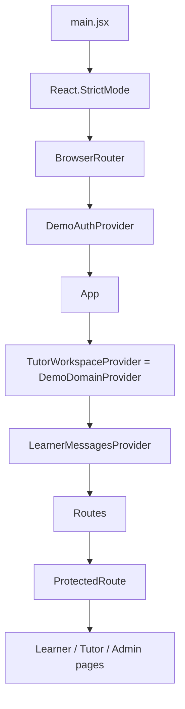
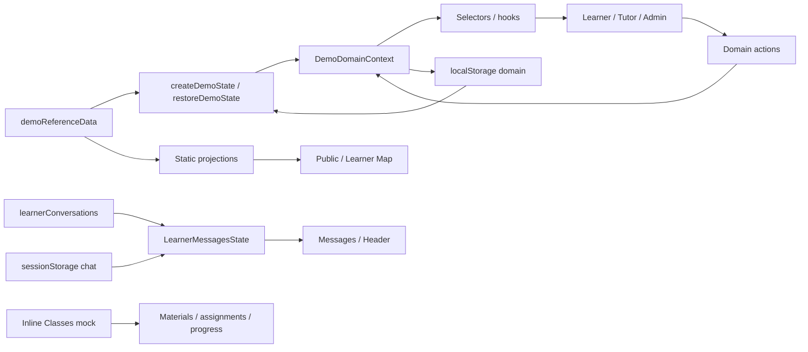
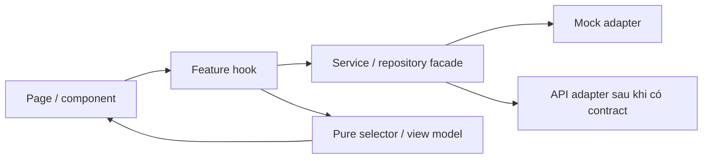

# Báo cáo kiến trúc frontend TutorNearMe

Ngày phân tích: 14/11/2026.

Phạm vi: toàn bộ frontend tại `apps/web`, đặc biệt `features/learner`.

Báo cáo dựa trên việc đọc routing, import, component, provider, selector, mock và cấu hình thực tế. Không suy chức năng chỉ từ tên file. Trong lượt audit không sửa mã nguồn và không chạy build/test. File Markdown này được tạo sau đó theo yêu cầu xuất báo cáo.

Các đường dẫn trong báo cáo tương đối với thư mục gốc dự án:

```text
D:\Downloads\TutorDemo-feature-frontend-learner\TutorDemo-feature-frontend-learner
```

## 1. Kết luận kiến trúc

TutorNearMe là React SPA chạy bằng Vite, frontend-only, dùng React Router, React Context, local state và browser storage. Chưa có backend/API thật, database hoặc lớp service/API riêng.

Những phần đã tổ chức tốt:

- Tách khu vực Learner, Tutor, Admin và các shell phù hợp từng role.
- Có shared UI primitives và semantic tokens.
- Có shared domain state cho requests, lessons, availability, profiles và moderation.
- Có pure domain functions và selectors ngoài JSX.
- Luồng Learner gửi request → Tutor xử lý → Learner xem kết quả sử dụng chung dữ liệu.

Vấn đề trọng tâm là nhiều cấp độ hoàn thiện dữ liệu đang cùng tồn tại:

1. Shared domain state có persistence.
2. Static projection trực tiếp từ fixture.
3. Mock riêng ngoài domain.
4. Mock/fallback nghiệp vụ trong component.
5. Local state chỉ mô phỏng thao tác.

Không phải mọi array hoặc chuỗi trong UI đều là hardcode nghiệp vụ. Navigation, icon, nhãn trạng thái, cấu hình tab và các lựa chọn UI tĩnh cần được phân biệt với dữ liệu người dùng/lớp/tài liệu.

## 2. Cấu trúc thư mục hiện tại

Đã bỏ qua `node_modules`, `.git`, `dist`, build output và thư mục tạm.

```text
apps/web/
├── index.html
├── package.json
├── package-lock.json
├── vite.config.js
├── playwright.config.js
├── vercel.json
├── src/
│   ├── main.jsx
│   ├── App.jsx
│   ├── components/
│   │   ├── Avatar.jsx
│   │   ├── Badge.jsx
│   │   ├── Brand.jsx
│   │   ├── Button.jsx
│   │   ├── RoleSwitcher.jsx
│   │   ├── SearchInput.jsx
│   │   ├── SidebarItem.jsx
│   │   ├── StatItem.jsx
│   │   └── components.css
│   ├── hooks/
│   │   ├── useDemoStorage.js
│   │   └── useDialogFocus.js
│   ├── data/
│   │   ├── demoReferenceData.js
│   │   ├── learner.js
│   │   ├── learnerConversations.js
│   │   ├── tutors.js
│   │   ├── tutorProfiles.js
│   │   ├── tutorSchedule.js
│   │   ├── tutorMap.js
│   │   ├── tutorConversations.js
│   │   ├── tutorClassMap.js
│   │   ├── tutorClassSearch.js
│   │   ├── tutorDashboard.js
│   │   ├── tutorDashboardReference.js
│   │   ├── adminDashboard.js
│   │   ├── public.js
│   │   ├── tutorSchedule.test.js
│   │   └── tutorClassSearch.test.js
│   ├── features/
│   │   ├── auth/
│   │   │   ├── DemoAuthContext.jsx
│   │   │   ├── authUtils.js
│   │   │   ├── AuthNavigation.jsx
│   │   │   ├── AuthFrame.jsx
│   │   │   ├── AuthProviderButtons.jsx
│   │   │   ├── LoginPage.jsx
│   │   │   ├── RegistrationPage.jsx
│   │   │   ├── PhoneAuthModal.jsx
│   │   │   └── auth.css
│   │   ├── domain/
│   │   │   ├── DemoDomainContext.jsx
│   │   │   ├── demoDomain.js
│   │   │   ├── statusMetadata.js
│   │   │   ├── incomeSelectors.js
│   │   │   ├── useAdminDomain.js
│   │   │   └── appeals.js
│   │   ├── learner/
│   │   │   ├── LearnerHeader.jsx
│   │   │   ├── LearnerAccountMenu.jsx
│   │   │   ├── LearnerAccountPanel.jsx
│   │   │   ├── LearnerDashboard.jsx
│   │   │   ├── LearnerSearch.jsx
│   │   │   ├── SearchFilters.jsx
│   │   │   ├── TutorCard.jsx
│   │   │   ├── TutorProfilePage.jsx
│   │   │   ├── BookingModal.jsx
│   │   │   ├── ProfileCalendar.jsx
│   │   │   ├── ProfileChoices.jsx
│   │   │   ├── profileSelection.js
│   │   │   ├── TutorRequestForm.jsx
│   │   │   ├── RequestSelectionDetails.jsx
│   │   │   ├── LearnerPages.jsx
│   │   │   ├── LearnerClassesPage.jsx
│   │   │   ├── LearnerSchedulePage.jsx
│   │   │   ├── LearnerMapPage.jsx
│   │   │   ├── TutorMap.jsx
│   │   │   ├── LearnerMessages.jsx
│   │   │   ├── LearnerMessagesState.jsx
│   │   │   ├── learner.css
│   │   │   ├── search.css
│   │   │   ├── profile.css
│   │   │   ├── dashboard.css
│   │   │   ├── learnerSchedule.css
│   │   │   ├── learner-messages.css
│   │   │   ├── header.css
│   │   │   └── account-menu.css
│   │   ├── tutor/
│   │   │   ├── TutorWorkspaceState.jsx
│   │   │   ├── TutorPages.jsx
│   │   │   ├── TutorDashboard.jsx
│   │   │   ├── TutorDashboardSupport.jsx
│   │   │   ├── TutorHeader.jsx
│   │   │   ├── TutorSidebar.jsx
│   │   │   ├── TutorScheduleChecks.jsx
│   │   │   ├── TutorTimetable.jsx
│   │   │   ├── LessonDetailModal.jsx
│   │   │   ├── TutorIncome.jsx
│   │   │   ├── TutorClassSearch.jsx
│   │   │   ├── TutorClassMap.jsx
│   │   │   ├── tutor.css
│   │   │   ├── timetable.css
│   │   │   ├── income.css
│   │   │   ├── dashboard-reference.css
│   │   │   └── class-search.css
│   │   ├── scheduling/
│   │   │   ├── WeeklyTimeline.jsx
│   │   │   ├── TimeConfirmation.jsx
│   │   │   ├── timelineGeometry.js
│   │   │   ├── timelineGeometry.test.js
│   │   │   └── weekly-timeline.css
│   │   ├── admin/
│   │   │   ├── AdminShell.jsx
│   │   │   ├── AdminDashboard.jsx
│   │   │   ├── AdminUsersPage.jsx
│   │   │   ├── AdminTutorsPage.jsx
│   │   │   ├── AdminReviewsPage.jsx
│   │   │   ├── AdminIssuesPage.jsx
│   │   │   ├── AdminAppealsPage.jsx
│   │   │   ├── AdminSlideOver.jsx
│   │   │   ├── AccountReportHistory.jsx
│   │   │   └── admin.css
│   │   ├── appeals/
│   │   │   ├── UserAppealsPage.jsx
│   │   │   ├── AppealForm.jsx
│   │   │   ├── AppealEvidence.jsx
│   │   │   └── appeals.css
│   │   └── public/
│   │       ├── HomePage.jsx
│   │       ├── LearnerLanding.jsx
│   │       ├── LearnerHero.jsx
│   │       ├── TutorLanding.jsx
│   │       ├── PublicChrome.jsx
│   │       ├── PublicPieces.jsx
│   │       ├── RoleSelectModal.jsx
│   │       └── public.css
│   └── styles/
│       ├── tokens.css
│       ├── reset.css
│       ├── global.css
│       └── flows.css
└── tests/
    ├── Các unit/domain tests được liệt kê ở mục 11
    └── e2e/
        ├── demoHelpers.js
        └── Các Playwright specs được liệt kê ở mục 11
```

### Công nghệ xác nhận từ cấu hình

| Thành phần | Hiện trạng |
| --- | --- |
| UI | React, JavaScript JSX |
| Routing | React Router |
| Build/dev server | Vite, plugin React |
| State | Context, useState, useMemo, useEffect |
| Persistence demo | localStorage, sessionStorage |
| Icon/font | Lucide React; Nunito/Nunito Sans |
| Styling | CSS thuần, CSS variables |
| Unit/E2E | Node test runner, Playwright |
| Backend client | Chưa có |
| TypeScript | Không thấy TSX trong frontend hiện tại |

## 3. Routing và provider

### 3.1. Cây provider thực tế



`TutorWorkspaceProvider` không tạo Tutor store độc lập. Trong `apps/web/src/features/tutor/TutorWorkspaceState.jsx`:

```js
export const TutorWorkspaceProvider = DemoDomainProvider;
```

Tên provider gợi Tutor, nhưng thực tế cung cấp shared domain cho toàn ứng dụng.

### 3.2. Route hiện có

Nguồn: `apps/web/src/App.jsx`.

| Khu vực | Route | Component/hành vi |
| --- | --- | --- |
| Public | `/` | HomePage |
| Public | `/learner` | LearnerLanding |
| Public | `/tutor` | TutorLanding |
| Auth | `/login` | LoginPage |
| Auth | `/register` | RegistrationPage role learner |
| Auth | `/tutor/register` | RegistrationPage role tutor |
| Learner | `/learner/search` | LearnerSearch |
| Learner | `/tutors/:id` | TutorProfilePage |
| Learner | `/requests/new` | NewRequest → hồ sơ gia sư và mở booking |
| Learner | `/requests` | MyRequests |
| Learner | `/requests/:id` | RequestDetail |
| Learner | `/learner/classes` | LearnerClassesPage |
| Learner | `/learner/classes/:id` | LearnerClassDetailPage |
| Learner | `/learner/classes/:id/:section` | LearnerClassDetailPage |
| Learner | `/learner/schedule` | LearnerSchedulePage |
| Learner | `/learner/messages` | LearnerMessages |
| Learner | `/learner/dashboard` | LearnerDashboard |
| Learner | `/map`, `/learner/map` | LearnerMapPage |
| Tutor | `/tutor/dashboard` | TutorDashboard |
| Tutor | `/tutor/profile` | TutorProfile |
| Tutor | `/tutor/requests`, `/tutor/requests/:id` | TutorRequests, TutorRequestDetail |
| Tutor | `/tutor/timetable` | TutorTimetable |
| Tutor | `/tutor/income` | TutorIncome |
| Tutor | `/tutor/find-students` | TutorClassSearch |
| Tutor | `/tutor/map` | TutorClassMap |
| Tutor legacy | `/tutor/availability`, `/tutor/lessons` | Redirect `/tutor/timetable` |
| Admin | `/admin/dashboard` | AdminDashboard |
| Admin | `/admin/users` | AdminUsersPage |
| Admin | `/admin/tutors` | AdminTutorsPage |
| Admin | `/admin/reviews` | AdminReviewsPage |
| Admin | `/admin/issues` | AdminIssuesPage |
| Admin | `/admin/appeals` | AdminAppealsPage |
| Shared | `/appeals` | UserAppealsPage, tự xử lý xác thực/truy cập giới hạn |
| Fallback | `*` | Redirect `/` |

Các route Learner/Tutor/Admin được bọc ProtectedRoute theo role. Guard dựa vào auth state trên trình duyệt, không phải authorization server.

## 4. Chức năng từng file

Quy ước: UI = giao diện/tương tác; State = Context/hook/persistence; Domain = xử lý nghiệp vụ/selector; Mock = fixture/minh họa; Config = cấu hình. Phụ thuộc trong bảng là phụ thuộc nội bộ chính và thư viện có ý nghĩa kiến trúc, không lặp từng icon.

### 4.1. Entry, cấu hình, hooks và styles nền tảng

| File | Chức năng | Import/phụ thuộc | Nguồn dữ liệu | Được sử dụng bởi |
| --- | --- | --- | --- | --- |
| `apps/web/index.html` | HTML root, metadata, lang vi | main.jsx | Tĩnh | Vite/browser |
| `apps/web/src/main.jsx` | Mount React, Router/auth, import CSS/font, đo scrollbar | React DOM, Router, App, Auth Context | DOM/browser | index.html |
| `apps/web/src/App.jsx` | Routing và composition provider | Pages, guards, providers | Route/context | main.jsx |
| `apps/web/package.json` | Scripts/dependencies | npm | Tĩnh | Tooling |
| `apps/web/package-lock.json` | Khóa dependency resolution | npm | Tĩnh | Cài đặt |
| `apps/web/vite.config.js` | Plugin React | Vite | Tĩnh | Dev/build |
| `apps/web/playwright.config.js` | Base URL, timezone, worker, webServer | Playwright | E2E_BASE_URL/localhost | E2E |
| `apps/web/vercel.json` | SPA rewrite về index.html | Hosting | Tĩnh | Vercel |
| `apps/web/src/hooks/useDialogFocus.js` | Focus trap, Escape, body lock, trả focus | React/DOM | Ref/callback | Các dialog/filter/modal |
| `apps/web/src/hooks/useDemoStorage.js` | Hook đọc/ghi JSON localStorage | React/storage | Caller truyền key/initialValue | Không thấy runtime static importer |
| `apps/web/src/styles/tokens.css` | Brand, typography, spacing, semantic variables/aliases | CSS | Tĩnh | main và component styles |
| `apps/web/src/styles/reset.css` | Reset browser styles | CSS | — | main.jsx |
| `apps/web/src/styles/global.css` | Base typography, focus, form, reduced motion, helpers | Tokens | — | main.jsx |
| `apps/web/src/styles/flows.css` | Shared flow/form/detail styles | Tokens | — | main.jsx và flow UI |

### 4.2. Shared UI

Đường dẫn gốc: `apps/web/src/components/`.

| File | Chức năng | Import/phụ thuộc | Nguồn dữ liệu | Được sử dụng bởi |
| --- | --- | --- | --- | --- |
| Avatar.jsx | Avatar initials/name/tone/size | Props | Props | Learner/Tutor/Admin |
| Badge.jsx | Semantic badge, optional dot | Props | Props | Các role |
| Brand.jsx | Logo/link thương hiệu | Router | Thương hiệu tĩnh | Admin shell; một số page có import |
| Button.jsx | Button variant/size/type | Props | Props | Các role |
| SearchInput.jsx | Search input có icon | Lucide/props | Value/callback | Search/AdminDashboard |
| SidebarItem.jsx | Navigation item | Router | Props | Tutor/Admin sidebar |
| StatItem.jsx | Thống kê | Props | Props | AdminDashboard |
| RoleSwitcher.jsx | Link các giao diện demo | Router | Route config | Không thấy runtime static importer |
| components.css | Style primitives | Tokens | — | main.jsx |

Chưa có một bộ shared Input/Modal/Table primitive thống nhất. Native HTML và CSS riêng chưa phải lý do bắt buộc thay toàn bộ.

### 4.3. Auth

Đường dẫn gốc: `apps/web/src/features/auth/`.

| File | Chức năng | Import/phụ thuộc | Nguồn dữ liệu | Được sử dụng bởi |
| --- | --- | --- | --- | --- |
| DemoAuthContext.jsx | Login/register/logout/update profile/provider/appeal-only demo | Fixture, authUtils, tutorSchedule | Fixture accounts; auth storage; domain users status | Main, guards, headers, account, domain |
| authUtils.js | Safe redirect, role destination, normalize phone/identity | Pure helpers | Tham số | Auth/navigation/appeals |
| AuthNavigation.jsx | AuthLink, ProtectedRoute, post-login destination | Router/auth/utils | Auth/URL | App, auth/public |
| AuthFrame.jsx | Auth shell và public header | PublicChrome/Router | Props/URL | Login/Register |
| AuthProviderButtons.jsx | Provider buttons | Lucide/callback | Props | Login/Register |
| LoginPage.jsx | Form login, provider/phone/redirect | Auth context/modal/utils | Form/mock auth | Route login |
| RegistrationPage.jsx | Đăng ký role, validate, provider-prefill | Fixture/auth/modal/utils | Form/catalog/provider payload | Register routes |
| PhoneAuthModal.jsx | Phone/OTP simulation, countdown | Focus hook/React | Input/mã demo | Login/Register |
| auth.css | Style auth | Tokens/public | — | main.jsx |

Không có OAuth Google/Facebook hoặc SMS backend thật. Một route login được dùng chung cho các role.

### 4.4. Shared domain

Đường dẫn gốc: `apps/web/src/features/domain/`.

| File | Chức năng | Import/phụ thuộc | Nguồn dữ liệu | Được sử dụng bởi |
| --- | --- | --- | --- | --- |
| DemoDomainContext.jsx | State trung tâm, persistence, commands/hooks | Auth, demoDomain, scheduling, income, appeals | Restore storage/fixture | Hầu hết flow nghiệp vụ |
| demoDomain.js | Seed/restore/migration; requests, lesson completion, moderation actions | Fixture/tutorSchedule | State/storage/tham số | Domain Context, Lesson modal eligibility |
| statusMetadata.js | Nhãn/tone request và completed projection | Pure helpers | Request | Learner/Tutor requests |
| incomeSelectors.js | Thu nhập theo completed Lessons, fee/tháng | Pure selectors | Lessons/reference date | useTutorIncome |
| useAdminDomain.js | Admin selectors/view models/hooks/actions facade | Appeals; dynamic Context import | Shared domain | Admin |
| appeals.js | Ownership/evidence validation/create/review/history selectors | Pure functions | Shared users/issues/appeals | Domain/appeals/Admin |

`useAdminDomain.js` trộn pure selectors và React hooks; dynamic import Context trong try/catch nhằm tương thích raw Node tests không có JSX loader.

### 4.5. Toàn bộ Learner

Đường dẫn gốc: `apps/web/src/features/learner/`.

| File | Chức năng thực tế | Import/phụ thuộc chính | Nguồn dữ liệu | Được sử dụng bởi |
| --- | --- | --- | --- | --- |
| LearnerHeader.jsx | Header, active theo route/origin, unread, account | PublicHeader/auth/messages | Auth/route/unread | Learner pages, Learner appeals |
| LearnerAccountMenu.jsx | Dropdown, keyboard/focus/dismissal | Avatar/Router | user/onLogout props | Header |
| LearnerAccountPanel.jsx | Xem/sửa profile/address | Auth/Button | Auth user | Dashboard |
| LearnerDashboard.jsx | Profile/saved/password tabs | Saved/scheduled hooks/account panel | Domain saves/profiles; local form | Dashboard route |
| LearnerSearch.jsx | Search/filter/sort/mobile dialog/save | Scheduled/saved hooks, QuickFilter, TutorCard | Domain profiles/schedule; UI options | Search route |
| SearchFilters.jsx | QuickFilter dropdown, outside close, available height | React/DOM | Props | Search |
| TutorCard.jsx | Card, profile link, save, lịch rảnh | Shared UI/public schedule hook | Tutor props/domain schedule | Search |
| TutorProfilePage.jsx | Find profile, reviews/calendar/credentials/booking/chat links | Domain/saved/BookingModal/Calendar | Profiles/reviews; fallback credentials | Profile route |
| BookingModal.jsx | Native dialog, selection/errors | Choices/Calendar/RequestForm | Tutor/URL/local selection | Profile |
| ProfileCalendar.jsx | Xem/chọn bookable sessions theo tuần | Public schedule hook/scheduling helpers | Saved availability/lessons hoặc weekly adapter | Profile/Booking |
| ProfileChoices.jsx | Pill/button options | Props | Props | Booking |
| profileSelection.js | Chia ranges thành sessions đủ duration; remove proposal; validation/labels | tutorSchedule | Tham số | Booking/Calendar/Form |
| TutorRequestForm.jsx | Validate và create request; navigate detail | Domain createRequest/proposal validation | Selection/tutor/URL | Booking |
| RequestSelectionDetails.jsx | Render subjects/levels/areas | Props | Request props | LearnerPages |
| LearnerPages.jsx | MyRequests, RequestDetail, NewRequest, shell và ID formatter | Domain hooks/status/Router | Shared requests/profiles; local filters/review | Request routes |
| LearnerClassesPage.jsx | Classes list/detail/materials/assignments và useLearnerClassesData | Domain/auth/scheduled tutors/UI | Accepted requests/lessons; inline mock/submissions | Classes routes |
| LearnerSchedulePage.jsx | Dated weekly board, upcoming/history/ongoing/time progress | Domain/auth/scheduled tutors | Lessons/requests/local clock/fallbacks | Schedule route |
| LearnerMapPage.jsx | Chọn area/tutor, map/distance demo | tutorMap mock/saved/TutorMap | Static map tutors/fixed learner location | Map routes |
| TutorMap.jsx | SVG map, pins, selection, keyboard | Import mapTutors | Mock pins + selected/learner props | MapPage |
| LearnerMessages.jsx | Inbox/filter/search/open query tutor/send local | Messages Context/scheduled tutors | Conversations/local draft | Messages route |
| LearnerMessagesState.jsx | Chat Context, restore/seed/unread/append/create | learnerConversations mock | SessionStorage/initial conversations | App/Header/Messages |

#### CSS Learner

| File | Phạm vi hiện tại | Phụ thuộc / nguồn | Được sử dụng bởi |
| --- | --- | --- | --- |
| learner.css | Nền tảng Learner | Tokens/shared classes | main.jsx |
| search.css | Search và nhiều pattern/container Learner | Tokens/public/global | Search/Profile/Dashboard/Map/Classes/Schedule/Requests |
| profile.css | Tutor profile và booking | Tokens/classes | TutorProfilePage và descendants |
| dashboard.css | Account dashboard | Tokens | Dashboard |
| learnerSchedule.css | Banner/stats/classes/materials/requests/weekly/live progress | Tokens/shared selectors | Classes/Schedule/LearnerPages |
| learner-messages.css | Inbox/chat/mobile | Learner/shared | Messages |
| header.css | Scoped Learner header | PublicHeader DOM | Header |
| account-menu.css | Account dropdown | Header/Avatar/tokens | AccountMenu |

Tên `search.css` và `learnerSchedule.css` hẹp hơn phạm vi consumer thực tế. Thay CSS một màn có thể ảnh hưởng màn khác.

### 4.6. Tutor và scheduling

Đường dẫn dưới `apps/web/src/`.

| File | Chức năng | Phụ thuộc / nguồn dữ liệu | Được sử dụng bởi |
| --- | --- | --- | --- |
| features/tutor/TutorWorkspaceState.jsx | Provider alias và Tutor/public schedule selectors | Domain Context/tutorSchedule | App/Tutor/nhiều Learner components |
| features/tutor/TutorPages.jsx | Shell/profile editor/request list/detail | Workspace/domain/scheduling/profile options | Tutor routes/TutorShell consumers |
| features/tutor/TutorDashboard.jsx | Overview/requests/agenda | Workspace/profile/income; trend cố định | Dashboard route |
| features/tutor/TutorDashboardSupport.jsx | Profile summary/income/quick links | Domain/income; completion/timestamp minh họa | Dashboard |
| features/tutor/TutorHeader.jsx | Topbar/account/logout | Auth/Avatar/Router | Dashboard/Shell |
| features/tutor/TutorSidebar.jsx | Navigation/pending count | SidebarItem/config/props | Dashboard/Shell |
| features/tutor/TutorScheduleChecks.jsx | Saved availability preview theo ngày/buổi | Workspace/schedule helpers/scheduleDays | Dashboard |
| features/tutor/TutorTimetable.jsx | Availability draft/duration/add/move/save/cancel/lesson detail | Workspace/Timeline/TimeConfirmation/LessonModal | Timetable route |
| features/tutor/LessonDetailModal.jsx | Detail/notes/complete | Portal/focus hook/domain eligibility | Timetable |
| features/tutor/TutorIncome.jsx | Monthly income/chart/lesson rows | Income hook/Selectors/TutorShell | Income route |
| features/tutor/TutorClassSearch.jsx | Filter requests phù hợp saved availability | Workspace/tutorClassSearch helpers | Find-students route |
| features/tutor/TutorClassMap.jsx | Pending request map/detail links | Workspace/static positions | Tutor map route |
| features/scheduling/WeeklyTimeline.jsx | Timeline, expand hour, drag/select, scroll | Geometry/scheduling, props/callbacks | Timetable |
| features/scheduling/TimeConfirmation.jsx | Date/time confirmation dialog | Focus/scheduling, props/local form | Timetable |
| features/scheduling/timelineGeometry.js | Pure geometry/overlap columns | Tham số | WeeklyTimeline |

| CSS file | Consumer/chức năng |
| --- | --- |
| features/tutor/tutor.css | Tutor nền tảng, main import |
| features/tutor/dashboard-reference.css | TutorDashboard |
| features/tutor/timetable.css | TutorTimetable |
| features/tutor/income.css | TutorIncome |
| features/tutor/class-search.css | TutorClassSearch |
| features/scheduling/weekly-timeline.css | WeeklyTimeline |

### 4.7. Admin và appeals

| File dưới apps/web/src/ | Chức năng | Phụ thuộc / nguồn dữ liệu | Được sử dụng bởi |
| --- | --- | --- | --- |
| features/admin/AdminShell.jsx | Header/sidebar/layout/logout | Auth/admin overview/shared UI | Admin pages |
| features/admin/AdminDashboard.jsx | Approvals/reviews/issues overview; live classes | Admin hooks; liveClasses mock trực tiếp | Admin dashboard route |
| features/admin/AdminUsersPage.jsx | Search/filter/detail/suspension | useAdminUsers/drawer | Admin route |
| features/admin/AdminTutorsPage.jsx | Approve/reject/suspend/filter/detail; export formatters | useAdminTutors/drawer | Route và Admin formatter consumers |
| features/admin/AdminReviewsPage.jsx | Filter/detail/approve/hide | useAdminReviews | Admin route |
| features/admin/AdminIssuesPage.jsx | Reports/warnings/dismissal/resolution/history | Admin issues/users hooks | Admin route |
| features/admin/AdminAppealsPage.jsx | Search/filter/read/review appeal | Domain/auth/appeals selectors | Admin route |
| features/admin/AdminSlideOver.jsx | Shared drawer | React/focus hook | Admin details |
| features/admin/AccountReportHistory.jsx | Reports/warnings history | Admin/history selectors | Issues page |
| features/admin/admin.css | Admin styles | Tokens | main.jsx |
| features/appeals/UserAppealsPage.jsx | Restricted auth/send/view own appeals | Auth/domain/appeals, shell theo role | /appeals |
| features/appeals/AppealForm.jsx | Form/FileReader/evidence validation | Appeals constants/callback | UserAppealsPage |
| features/appeals/AppealEvidence.jsx | File/link evidence render | Safe evidence helper | User/Admin appeals |
| features/appeals/appeals.css | Appeal styles | Tokens | User/Admin appeals |

### 4.8. Public

Đường dẫn gốc: `apps/web/src/features/public/`.

| File | Chức năng | Phụ thuộc / nguồn dữ liệu | Được sử dụng bởi |
| --- | --- | --- | --- |
| HomePage.jsx | Homepage/role chooser/consult form | PublicChrome/RoleModal/photo | / |
| LearnerLanding.jsx | Learner landing/tutor filters/saved/dialog | Static publicTutors + domain saved IDs | /learner |
| LearnerHero.jsx | Hero | Photo/nội dung tĩnh | LearnerLanding |
| TutorLanding.jsx | Tutor landing/request cards/calculator/slot demo | publicRequests/photo/local state | /tutor |
| PublicChrome.jsx | Sticky/mobile Header/Footer/Dialog/SectionHead | Router/focus hook/props/config | Public/Auth/Learner |
| PublicPieces.jsx | PublicTutorCard/MapPreview/DemoLink | Props/money/AuthLink/pin config | Landings |
| RoleSelectModal.jsx | Chọn role đi đăng ký | Router/focus | Home |
| public.css | Public chrome/landing styles | Tokens | main.jsx |

Form tư vấn homepage chỉ đặt local state `consulted`; chưa gửi hoặc lưu bản ghi tư vấn.

## 5. Services, mock và persistence

### 5.1. Tất cả nguồn data

Đường dẫn gốc: `apps/web/src/data/`.

| File | Vai trò | Consumer/lưu ý |
| --- | --- | --- |
| demoReferenceData.js | Fixture trung tâm immutable: accounts/profiles/requests/lessons/reviews/issues/catalog/provider payloads… | Domain seed/restore/auth/projections |
| learner.js | Requests projection cho demo-learner | Không thấy runtime static importer |
| learnerConversations.js | Learner chat mock và sanitize | Messages State |
| tutors.js | Static tutor profiles projection/options | Public/map; Search chỉ lấy availability options |
| tutorProfiles.js | Profile map/levels/formatters/reviews projection | TutorPages; không phải nguồn chính Learner profile |
| tutorSchedule.js | Scheduling domain logic + compatibility seed adapter | Booking/scheduling/domain/Tutor |
| tutorMap.js | Static tutor snapshot + synthetic coordinates/distance | LearnerMapPage/TutorMap |
| tutorConversations.js | Tutor chat mock | Không thấy runtime static importer |
| tutorClassMap.js | Request-ID positions | TutorClassMap |
| tutorClassSearch.js | Fixture metadata + availability matching/filtering | Tutor discovery/dashboard/formatting |
| tutorDashboard.js | Legacy examples và seed projections | Không thấy runtime static importer |
| tutorDashboardReference.js | Legacy examples/day-period UI config | ScheduleChecks dùng scheduleDays |
| adminDashboard.js | Mock approvals/live classes/reviews/issues riêng | AdminDashboard dùng liveClasses |
| public.js | Photo URLs/static tutors/public requests/money formatter | Public; LearnerPages chỉ dùng formatter |

Không thấy runtime importer không đồng nghĩa có thể xóa: test hoặc tài liệu có thể còn dùng.

### 5.2. Service/API hiện tại

| Câu hỏi | Kết quả xác minh |
| --- | --- |
| Có services/ hoặc api/? | Không |
| Có API client fetch/axios? | Không thấy lời gọi nghiệp vụ trong mã đã rà soát |
| Có realtime transport WebSocket/EventSource? | Không |
| Service nào dùng mock? | Chưa có service đúng nghĩa; Context/domain actions đảm nhiệm thao tác demo |
| Upload thật? | Không; submissions chỉ metadata local; appeals đọc data URL trên browser |
| Có network khác? | Có tải ảnh ngoài như Unsplash, không phải API nghiệp vụ |

### 5.3. Persistence

| Vùng | Storage | Nội dung | Account scope |
| --- | --- | --- | --- |
| Auth | tutornearme.demo-auth.v1, local/session | User/accounts/session demo | Phiên hiện tại và accounts |
| Shared domain | tnm.demo.domain.v1, localStorage | Profiles/requests/lessons/availability/settings/users/reviews/issues/appeals/saves | Shared state; selectors lọc ownership; saves theo user ID |
| Learner chat | tutornearme_learner_conversations_v2, sessionStorage | Conversations/messages/unread | Không keyed account |
| Submissions | React state | File metadata/status/feedback | Không persistence theo class |
| Booking draft | React state | Selection/goal | Vòng đời component |
| Password form | React state | Inputs/feedback | Không đổi credential |

Domain restore có đọc legacy keys để migration. Đây là compatibility frontend, không phải database migration.

### 5.4. Sơ đồ dữ liệu



## 6. Luồng Learner thực tế

### 6.1. Tìm gia sư

```text
Nhập từ khóa/chọn filter
→ LearnerSearch
→ useScheduledTutors
→ shared profiles + selectPublicTutorSchedule
→ useMemo filter/sort
→ TutorCard
```

Có tìm tên/trường/khu vực/môn; lọc môn/khu vực/lịch rảnh/phí; sort giá/rating/recommended; lưu qua useSavedTutors. Chưa có server search, server pagination hoặc network loading/error.

### 6.2. Xem profile

```text
Nhấn TutorCard → /tutors/:id → TutorProfilePage
→ useDemoDomain.profiles/reviews
→ approved profile, reviews, calendar, credentials
```

Review summary lấy approved/public reviews của Tutor. Card lại lấy profile.rating/profile.reviews: hai nguồn aggregate có thể lệch.

### 6.3. Booking và gửi request

```text
Đặt lịch → BookingModal → ProfileChoices/ProfileCalendar
→ usePublicTutorSchedule → availability trừ occupied Lessons
→ bookableSessions → TutorRequestForm
→ useTutorProposalValidation → domain.createRequest
→ addLearnerRequest → shared requests → /requests/:id
```

Kiểm tra môn/cấp độ/hình thức/khu vực khi cần, concrete date/start/end, thời gian tương lai, duration, containment và validate lại lúc submit. Fee snapshot từ Tutor. Chưa có API.

### 6.4. Theo dõi request

```text
/requests → MyRequests → useLearnerRequests
→ requests theo learnerId + requestIsCompleted(linked Lessons)
→ thống kê/tabs/cards
```

```text
/requests/:id → RequestDetail
→ requests/profiles/status helpers
→ summary/schedule/cancel/review UI
```

Domain cho cancel pending và chỉ ghi review khi requestIsCompleted. UI lại mở review cả khi accepted. Đây là mâu thuẫn có bằng chứng: người dùng có thể submit nhưng domain không lưu vì chưa completed.

### 6.5. Tutor chấp nhận lớp

```text
Tutor accept → decideRequest/acceptanceResult
→ Lessons từ concrete proposals
→ trừ occupied availability
→ shared domain
→ Learner requests/classes/schedule đọc lại
```

Đây là phần đồng bộ tốt của prototype.

### 6.6. Lớp học

```text
/learner/classes → useLearnerClassesData trong page
→ accepted requests + lessons + scheduled tutors
→ class view models → filter/cards
```

Chưa có collection Class riêng; class.id là request ID. Hook có thể tự chèn demo-02 cho demo learner, progress đang cố định với lớp chưa hoàn tất, và match Lessons còn dùng tutorId+learnerId ngoài requestId.

### 6.7. Thời khóa biểu

```text
/learner/schedule → requests + domain.lessons + tutors
→ owned Lessons → dated week/upcoming/history/ongoing
→ weekly board/session cards
```

- Tuần Thứ 2–Chủ nhật, chuyển tuần trước/sau/hiện tại.
- Bảng gắn actual Lesson vào đúng lesson.date, không lặp lịch lớp thành buổi giả.
- Lịch lớp chưa có dated Lesson nằm riêng.
- Upcoming: confirmed/upcoming và start > now.
- History: status completed.
- Ongoing: confirmed/upcoming và start <= now < end.
- Time progress cập nhật mỗi giây; hết giờ không tự completed.
- Clock/timezone dựa vào browser, chưa có server clock.

### 6.8. Materials và assignments

```text
Class detail → classMaterialsBySubject → material cards
Nhấn xem/tải → setPreviewDoc → metadata modal
```

Không thấy download binary hoặc PDF thật.

```text
Chọn file/nhập tên → handleUploadSubmit
→ setSubmissions → metadata array → success UI
```

Chưa có material/submission service, upload thật, persistence theo lớp hoặc đồng bộ bài nộp/điểm sang Tutor.

### 6.9. Tin nhắn

```text
Profile Nhắn tin → /learner/messages?tutorId=...
→ LearnerMessages → getOrCreateConversation
→ Messages Context → sessionStorage/initial mock → chat UI
```

Gửi tin chỉ append local; không tới Tutor thật. New conversation tự tạo lời chào dưới danh nghĩa Tutor.

### 6.10. Tài khoản và saved tutors

```text
AccountPanel submit → auth.updateProfile → validate
→ auth user/accounts storage → UI
```

```text
Save tutor → useSavedTutors.setSaved
→ savedByAccount[user.id] → Search/Profile/Dashboard
```

PasswordPanel chỉ so sánh new/confirm rồi setFeedback, không đổi mật khẩu trong auth state.

### 6.11. Bản đồ

```text
LearnerMapPage → mapTutors từ tutorMap.js
→ static profiles + synthetic coordinates
→ SVG TutorMap và demoDistance
```

Không phải geolocation, geocoding, khoảng cách đường đi hoặc Maps API thật.

## 7. Audit hardcode

Rà soát kiến trúc rộng hơn xác nhận 8 file Learner có mock nghiệp vụ, fallback nghiệp vụ hoặc direct mock dependency. Con số 4 file trong trao đổi sơ bộ trước đó chưa bao quát toàn bộ phạm vi audit.

### 7.1. Các trường hợp Learner

Đường dẫn dưới `apps/web/src/features/learner/`.

| File | Biến/dữ liệu | Đang dùng | Mức độ cần tách | Đề xuất |
| --- | --- | --- | --- | --- |
| LearnerClassesPage.jsx | classMaterialsBySubject | Materials | Cao | Fixture + materials theo classId/materialId |
| LearnerClassesPage.jsx | accepted.unshift demo-02 | Class fallback | Cao | Seed trong mock adapter, không invent trong UI |
| LearnerClassesPage.jsx | doneCount 2/total 6/min completed 4 | Progress | Cao | Selector theo lesson/plan đã xác nhận |
| LearnerClassesPage.jsx | Initial submissions/score/feedback | Assignments | Cao | Mock theo class/account; repository |
| LearnerClassesPage.jsx | classes[0]/tutors[0]/fee fallback | Detail/view model | Cao | Not-found/unknown, không thay entity |
| TutorProfilePage.jsx | default-doc-1/2, verified | Missing credentials | Cao | Không tạo bằng chứng giả |
| TutorProfilePage.jsx | Nhãn Đã đối chiếu cố định | Document card | Cao | Render theo verification status thật |
| LearnerMapPage.jsx | LEARNER_LOCATION Quận 1/x/y | Location/distance | Trung bình; cao khi map thật | Location adapter/profile |
| LearnerMapPage.jsx | mapTutors direct import | Options/list/selection | Cao cho đồng bộ profile | Runtime hook/repository |
| TutorMap.jsx | mapTutors/fallback Quận 1 | Pins/aria-label | Trung bình | Dataset/location từ props |
| LearnerSchedulePage.jsx | demo-02/Trần Gia Bảo/match Tutor để suy lớp | Links/identity fallback | Cao | Liên kết ID đúng; thiếu thì không link sai |
| LearnerPages.jsx | publicTutors[0], default format/location, demo prefix code | Request pages | Cao với entity fallback | Mapper/not-found; không lấy record đầu |
| LearnerSearch.jsx | 4.9, 150k+, 100% claim | Spotlight/trust | Trung bình | Nội dung marketing rõ hoặc summary selector |
| LearnerMessagesState.jsx | Intro from them, fallback unread 2 | Conversation/fallback hook | Cao trước chat thật | Mock adapter riêng; không giả Tutor message |

### 7.2. UI config không tính là hardcode nghiệp vụ

- Navigation labels/routes/icons.
- Thứ trong tuần, tab IDs, sort options.
- Nhãn trạng thái/tone.
- Số sao 1–5.
- Filter presets do sản phẩm định nghĩa.
- Placeholder/empty-state text.
- Màu môn học.
- Pin layout chỉ nhằm trang trí nếu được ghi rõ là minh họa.

Không cần đẩy mọi chuỗi/array lên API.

### 7.3. Direct mock imports

| Component | Import | Ý nghĩa |
| --- | --- | --- |
| LearnerMapPage | data/tutorMap.js | Dataset profile khác nguồn runtime |
| TutorMap | data/tutorMap.js | Presentation phụ thuộc fixture |
| LearnerMessagesState | data/learnerConversations.js | Hợp lý cho demo provider nhưng cần adapter/account scope |
| LearnerSearch | data/tutors.js | Chỉ availability options, không phải tutor list |
| LearnerPages | data/public.js | Chỉ money formatter, không phải public tutor dataset |
| DemoAuthContext | demoReferenceData.js | Có chủ đích cho auth demo, cần thay implementation khi backend |
| RegistrationPage | demoReferenceData.js | Catalog/options cần boundary sau này |
| Public landings | data/public.js | Static dataset chưa đồng bộ runtime |
| AdminDashboard | data/adminDashboard.js | Live classes chưa lấy canonical Lessons |

Ngoài Learner: TutorDashboard có trend +2 cố định; TutorDashboardSupport có profile completion 85% và Đã lưu 2 phút trước. Nội dung landing marketing tĩnh cần phân biệt với thống kê nghiệp vụ thật.

## 8. Đánh giá ưu tiên

### P1 — Trước khi tích hợp backend của chức năng tương ứng

| Vấn đề | Bằng chứng | Ảnh hưởng | Hướng xử lý đề xuất |
| --- | --- | --- | --- |
| Thiếu data-access boundary | Context gọi domain action và ghi toàn state storage | Không có chỗ thay mock/async rõ | Repository/service facade, feature hooks |
| Classes/progress dựng trong page | Classes:89,104,109 | Trộn Lessons, progress sai | Selector và class association rõ |
| Materials/submissions inline | Classes:34,337,379 | Không persistence/upload thật | Tách fixture/repository theo class |
| Fallback entity khác | Classes:329; LearnerPages:186,306; Schedule | Mở sai lớp/Tutor khi ID thiếu | Not-found/unknown thay fallback entity |
| Review UI/domain khác điều kiện | LearnerPages:488 vs updateLearnerRequest | Submit không lưu | Một canReview selector và action result |
| Request review khác reviews collection | request.review/rating vs domain.reviews | Profile/Admin không thấy review mới | Nguồn chuẩn và mapper thống nhất |
| Password chỉ success UI | Dashboard:193–206 | Hiểu nhầm đã đổi credential | Nối auth service hoặc ghi rõ chưa hỗ trợ |
| Chat không keyed account | MessagesState:5, provider không theo auth | Các tài khoản cùng phiên có thể thấy chung chat | Account-scoped store/cache/reset |
| Fabricated verified docs | TutorProfilePage:429,462 | Trust badge không có bằng chứng | Không invent credentials |
| Auth demo không production | Password client-side và demo storage | Không phải security boundary thật | Thay auth adapter/authorization server khi có backend |
| Auth users và domain.users tách | updateProfile chỉ cập nhật auth; domain merge chủ yếu status | Identity có thể lệch giữa màn | Account/profile contract và cache update thống nhất |

Các yêu cầu production không phải chỉ thị tự triển khai backend trong giai đoạn frontend-only.

### P2 — Dễ bảo trì

| Vấn đề | Ảnh hưởng | File liên quan |
| --- | --- | --- |
| Tutor provider thực ra toàn domain | Dependency khó hiểu | App/TutorWorkspaceState/Context |
| Learner import shared hooks từ Tutor | Sai ownership module | Search/Schedule/Classes/Calendar/Card/Form |
| Context rộng | Consumer subscribe toàn state, hook recompute | Context/useScheduledTutors |
| Filter/map logic trong page | Khó test/tái dùng khi API | Search/Classes/Schedule/Requests |
| Date/time helpers lặp | Khó thống nhất timezone/validation | Schedule/tutorSchedule |
| Ownership theo tên | Tên không phải stable ID | Schedule |
| Rating nhiều nguồn | Card/detail có thể lệch | Card/Profile |
| Cancelled tab slice(0,1) | Chỉ hiện một request đã hủy | LearnerPages:97 |
| CSS dùng chéo màn | Regression khi sửa selector | search.css/learnerSchedule.css |
| Import formatter từ page | Page phụ thuộc page khác | AdminTutorsPage/consumers |
| Domain logic trong data/ | Fixture và rule khó phân biệt | tutorSchedule/tutorClassSearch |
| Selector/hook trộn | Dynamic import/catch vì test | useAdminDomain |
| Public/map snapshot | Không phản ánh mutable profiles | public.js/tutorMap.js |
| Chưa có async lifecycle | Thiếu pending/retry/network errors | Form/data commands |
| Dated seed hết hạn | Upcoming/live demo sẽ cũ | demoReferenceData |
| Reconciliation nạp record thiếu | Không phù hợp chạy trên API state | demoDomain |
| Route imports/CSS toàn cục | Có nguy cơ bundle/re-render lớn | App/main/providers |

Hiệu năng trên là nguy cơ cần đo, không phải kết luận đã có lỗi chậm nghiêm trọng.

### P3 — Có thể giữ hiện tại

| Thành phần | Lý do |
| --- | --- |
| React Context | Không cần đổi Redux/Zustand để có data boundary |
| Shared login | Phù hợp role resolving và redirect |
| Role shells khác nhau | Đúng UX từng role |
| CSS thuần/tokens | Đủ nếu scope được quản lý |
| Native dialog | Có thể giữ |
| Shared primitives | Ranh giới props hợp lý |
| SVG map minh họa | Giữ nếu không tuyên bố dữ liệu vị trí thật |
| Client time progress | Chỉ đo thời gian lịch, không attendance/completion |
| Immutable fixture | Tốt cho seed/test, tách khỏi API runtime |
| UI static config | Không cần service |

## 9. Những câu hỏi dữ liệu cần chốt

Đây là nhận định/đề xuất, chưa phải business rule cuối cùng.

| Câu hỏi | Code hiện tại | Cần xác nhận |
| --- | --- | --- |
| Class có phải accepted Request? | Class ID = Request ID | Resource Class riêng hay projection? |
| Tổng buổi lấy từ đâu? | Ongoing class cố định 6 | Lesson plan/package/enrollment? |
| Lesson không requestId thuộc lớp nào? | Fallback Tutor+Learner/request đầu | Cho unknown history hay classId bắt buộc? |
| Tài liệu theo môn hay lớp? | Theo tên môn | Material scope/ownership |
| Submission thuộc assignment? | Chưa assignment ID | Assignment/submission/review relation |
| Khi nào review? | UI accepted/domain completed | Một eligibility thống nhất |
| Rating nguồn chuẩn? | Profile aggregate và reviews derive | Server aggregate hay client selector? |
| Ongoing có nghĩa đã tham gia? | Chỉ clock interval | Scheduled time khác attendance |
| Class completion? | Mọi linked non-cancelled Lesson completed | Lesson plan chưa tạo đủ/buổi bù/test? |
| Chat liên role? | Chỉ Learner session local | Membership/transport/event source |

Không nên suy database schema cuối từ các trạng thái UI hiện tại.

## 10. Cấu trúc refactor đề xuất

Chỉ đề xuất, chưa thực hiện. Không cần đổi stack hoặc viết lại UI.

```text
apps/web/src/
├── app/
│   ├── AppProviders.jsx                 # mới: composition rõ tên
│   └── routes.jsx                       # có thể tách từ App
├── components/                          # giữ primitives
├── styles/                              # giữ tokens/reset/global
├── hooks/                               # shared UI hooks
├── data/
│   ├── demoReferenceData.js              # giữ trong chuyển tiếp
│   └── mocks/
│       ├── classMaterials.mock.js       # tách inline data
│       └── classSubmissions.mock.js
├── services/
│   ├── authService.js
│   ├── tutorService.js
│   ├── requestService.js
│   ├── classService.js
│   ├── lessonService.js
│   ├── materialService.js
│   ├── submissionService.js
│   ├── conversationService.js
│   └── adapters/
│       ├── mock/
│       └── api/                         # chỉ khi có contract
└── features/
    ├── domain/
    │   ├── DemoDomainContext.jsx         # giữ adapter demo chuyển tiếp
    │   ├── requestSelectors.js
    │   ├── classSelectors.js
    │   ├── lessonSelectors.js
    │   ├── reviewSelectors.js
    │   └── ...                          # giữ income/appeals/status
    ├── scheduling/
    │   ├── scheduleUtils.js
    │   ├── usePublicTutorSchedule.js
    │   ├── useTutorProposalValidation.js
    │   └── ...                          # giữ Timeline/geometry/dialog
    └── learner/
        ├── LearnerClassesPage.jsx       # list only
        ├── LearnerClassDetailPage.jsx
        ├── ClassMaterials.jsx
        ├── ClassAssignments.jsx
        ├── LearnerRequestsPage.jsx
        ├── LearnerRequestDetailPage.jsx
        ├── LearnerSchedulePage.jsx
        ├── ScheduleSection.jsx          # nếu cần tái dùng/test riêng
        ├── hooks/
        │   ├── useLearnerClasses.js
        │   ├── useLearnerSchedule.js
        │   ├── useClassMaterials.js
        │   ├── useClassSubmissions.js
        │   └── useLearnerMessages.js
        └── ...                          # giữ UI nhỏ hiện có
```

Không cần tạo toàn bộ service cùng lúc. Bắt đầu bằng feature classes/materials/submissions đang refactor.



| File/nhóm | Đề xuất |
| --- | --- |
| Avatar/Button/Badge/SearchInput/SidebarItem | Giữ |
| Tokens/reset/global/role shells | Giữ, không redesign |
| Header/AccountMenu | Giữ UI, thay nguồn user/unread qua hook khi cần |
| Choices/RequestSelectionDetails | Giữ presentation |
| profileSelection/geometry/income selectors | Giữ pure functions |
| LearnerClassesPage | Tách hook/data/detail/materials/assignments |
| LearnerPages | Tách list/detail/redirect/formatters |
| LearnerSchedulePage | Tách selector/date-time, giữ layout |
| TutorProfilePage | Bỏ fabricated docs, tách credentials/reviews nếu cần |
| LearnerMapPage/TutorMap | Props dataset và runtime source hook |
| MessagesState | Adapter/persistence/account scope |
| DemoAuthContext | Giữ hook contract tạm, thay implementation khi server |
| DemoDomainContext | Giữ demo provider, không trộn API state với seed reconciliation |
| TutorWorkspaceState | Public/shared hooks sang scheduling/domain |
| useAdminDomain | Pure selectors riêng, React hooks riêng |
| search.css/learnerSchedule.css | Tách dần trách nhiệm, giữ appearance |

## 11. Kiểm thử hiện có và đề xuất

### File test hiện có

| Nhóm | Đường dẫn/file |
| --- | --- |
| Domain | apps/web/tests/demoDomain.test.js |
| Admin/auth | apps/web/tests/adminAuthGuard.test.js, adminDomain.test.js, adminCrossRoleSync.test.js, adminOperational.test.js, adminE2EScenarios.test.js, adminReviewMetrics.test.js, adminTestHelpers.js |
| Appeals | apps/web/tests/appeals.test.js |
| Income | apps/web/tests/incomeSelectors.test.js |
| Booking | apps/web/tests/profileSelection.test.js |
| Learner helper/seed | apps/web/tests/learnerMessagesAndMap.test.js, learnerScheduleSeed.test.js |
| Schedule helpers | apps/web/src/data/tutorSchedule.test.js |
| Tutor matching | apps/web/src/data/tutorClassSearch.test.js |
| Geometry | apps/web/src/features/scheduling/timelineGeometry.test.js |
| E2E helper | apps/web/tests/e2e/demoHelpers.js |
| Learner E2E | apps/web/tests/e2e/learner-search.spec.js, learner-account-menu.spec.js, learner-tutor-interface.spec.js |
| Auth/domain E2E | apps/web/tests/e2e/auth-regressions.spec.js, account-scoping.spec.js, domain-regressions.spec.js |
| Timetable E2E | apps/web/tests/e2e/timetable-regressions.spec.js, timetable-history.spec.js |
| Income E2E | apps/web/tests/e2e/income.spec.js |
| Admin E2E | apps/web/tests/e2e/admin-flow.spec.js, admin-improvements.spec.js, admin-journey-qa.spec.js |
| Responsive | apps/web/tests/e2e/responsive.spec.js |

Các tên sau dấu phẩy cùng hàng nằm trong thư mục đã ghi ở đầu hàng. Trong audit này không chạy lại test; danh sách không phải tuyên bố mọi hành vi hiện tại đã được suite bao phủ.

### Test nên bổ sung khi refactor

- ID lớp không tồn tại phải not-found, không mở lớp đầu.
- Nhiều lớp cùng Tutor/Learner không trộn Lessons.
- Progress derive từ dữ liệu, không cố định 2/6.
- Chuyển lớp không mang submissions lớp trước.
- Submission persistence theo lớp/account.
- UI/action dùng chung canReview.
- Review xuất hiện đúng nguồn mà profile/Admin đọc.
- Đổi account không dùng chung inbox.
- Thiếu credentials không hiện verified.
- Mutable profile đồng bộ các màn nếu cùng dùng runtime data.
- API pending/error/not-found không fallback sang demo entity.
- Ongoing before/start/end không tự complete.

## 12. Thứ tự refactor

### Giai đoạn 1: Chốt hành vi và loại bỏ dữ liệu gây hiểu nhầm

1. Review eligibility UI/domain.
2. Password success simulation.
3. Fallback entity sai.
4. Fabricated verified credentials.
5. Chat account scope.
6. Phân biệt demo và dữ liệu đã xác nhận.

### Giai đoạn 2: Learner classes

1. Tách useLearnerClassesData khỏi page.
2. Class/Lesson association rõ.
3. Tách material/submission mocks.
4. Hook/repository mock theo class.
5. Tách detail khỏi list.
6. Progress selector được thống nhất.

### Giai đoạn 3: Data boundary

1. Service/repository facade theo feature.
2. UI dùng feature hooks.
3. Pure schedule logic tách fixture.
4. Provider composition rõ tên.
5. API adapter sau khi contract được duyệt.

### Giai đoạn 4: Bảo trì

1. CSS boundaries.
2. Admin selectors/hooks.
3. Legacy unused runtime modules.
4. Lazy route khi cần và có đo.
5. Ownership/missing-data/API-failure tests.

## 13. Rủi ro khi refactor

| Rủi ro | Kiểm soát |
| --- | --- |
| Mất Learner/Tutor sync | Giữ request/lesson IDs và cross-role regression |
| Seed ghi đè API | Restore chỉ trong mock adapter |
| Reset làm mất demo edits | Versioned migration, không reset tùy tiện |
| Đổi nghĩa progress | Chốt denominator/eligibility |
| Orphan history gán nhầm lớp | Không suy theo Tutor/name; cho unknown |
| CSS regression liên màn | Kiểm tra toàn consumer selector |
| Route/shell đổi không cần | Giữ URLs/navigation state |
| Ongoing bị hiểu là attendance | Chỉ scheduled-time progress |
| Auth redirect/provider hỏng | Giữ shared login và safe redirect tests |
| Refactor quá rộng | Vertical slice có test, không đổi stack cùng lúc |

## 14. Tổng kết và danh sách ưu tiên

### Tổ chức tốt

- Role folders/shells, shared primitives/tokens.
- Shared domain cho flow chính và pure functions.
- Concrete proposals, snapshot lesson fee.
- Income từ completed Lessons.
- Test ownership/scheduling/cross-role.
- Immutable seed và restore/reconciliation rõ.

### Chưa hợp lý

- Chưa có service/API boundary.
- Classes page chứa quá nhiều trách nhiệm và inline mock.
- Progress chưa phản ánh nguồn dữ liệu thật.
- Fallback invent/open sai entity.
- Chat/submissions/password chưa hoàn thiện như UI gợi ý.
- Nhiều nguồn rating/account/map/public.
- Shared hooks đặt trong Tutor feature.
- Domain logic trộn fixture trong data/.
- CSS dùng chéo nhiều màn.

### Ưu tiên kiểm tra file

1. apps/web/src/features/learner/LearnerClassesPage.jsx
2. apps/web/src/features/learner/LearnerPages.jsx
3. apps/web/src/features/learner/LearnerMessagesState.jsx
4. apps/web/src/features/learner/TutorProfilePage.jsx
5. apps/web/src/features/learner/LearnerDashboard.jsx
6. apps/web/src/features/learner/LearnerSchedulePage.jsx
7. apps/web/src/features/domain/DemoDomainContext.jsx
8. apps/web/src/features/domain/demoDomain.js
9. apps/web/src/features/auth/DemoAuthContext.jsx
10. apps/web/src/features/tutor/TutorWorkspaceState.jsx
11. apps/web/src/data/tutorSchedule.js
12. apps/web/src/features/learner/LearnerMapPage.jsx

Hướng phù hợp là refactor từng phần quanh data boundary, giữ UI và flow hoạt động. Không có bằng chứng cần viết lại toàn frontend. Những mục đề xuất trong báo cáo chưa phải implementation hoặc database/business contract đã được phê duyệt.
