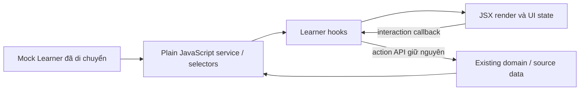

# Báo cáo refactor dữ liệu Learner

## 1. Phạm vi và danh sách đã quét

Đã đọc/quét toàn bộ **33 file JS/JSX ban đầu** dưới `features/learner/`, kể cả `wallet/`. Chỉ sửa/thêm source trong `features/learner/`, `data/learner/`, `services/learner/`. Không sửa App/main, cấu hình, CSS, dữ liệu gốc hoặc code Tutor/Admin/Auth/Public/Scheduling/Domain. Kiểm tra checksum 145 file source/config ban đầu: 15 file thay đổi, đều thuộc Learner; 130 file còn lại giữ nguyên. Không có thay đổi CSS.

| File đã quét | Phân loại và xử lý |
|---|---|
| `LearnerClassesPage.jsx` | Mock tài liệu, lớp dự phòng, bài nộp; projection requests/lessons/tutors; count/filter/progress và tạo bài nộp → data/service/hooks. UI filter, tab, preview, file input, draft/note/feedback vẫn tại JSX. Giữ named export `useLearnerClassesData` để tương thích. |
| `LearnerSchedulePage.jsx` | Context requests/lessons/user, map lesson, ownership, upcoming/completed/live, tiến độ và nhóm theo tuần → service/hook. Clock một giây, tuần đang xem, weekday labels và navigation vẫn tại component. |
| `LearnerPages.jsx` | Requests/public tutors từ domain; count/filter/priority/date sort, tutor join/detail và patch → service/hooks. Shell, request-code formatter, icons, tabs, review draft và report dialog state giữ nguyên. |
| `TutorProfilePage.jsx` | Domain profiles/reviews; lookup/moderation/visibility, average/featured/distribution → service/hook. Hai credential dự phòng → data factory; JSX nhận docs qua props. Saved hook hiện có, dialog/video/image state và formatting giữ nguyên. |
| `LearnerMessagesState.jsx` | Context boundary giữ nguyên; store composition/effects → hook; session persistence và factories/updates → service. Không đổi provider API hoặc storage keys. |
| `LearnerSearch.jsx` | Dynamic subject/location options, keyword/filter/sort → discovery service/hook. Query/filter selection, filter dialog, scroll/focus, price/sort options và icons là UI config, giữ tại JSX. |
| `LearnerMapPage.jsx` | Vị trí Learner minh họa → data; selection/options/distance/filter → map service/hook. Selected area/tutor và save interaction giữ tại component. |
| `TutorMap.jsx` | Trước đây import map tutors trực tiếp; nay nhận cùng array qua props từ parent. SVG/địa danh/path/geometry là minh họa UI, không tách. Không có consumer ngoài Learner. |
| `LearnerDashboard.jsx` | Saved tutors lấy qua domain facade hiện có; phép lọc saved → discovery hook/service. Tabs, hash scroll, password form UI giữ nguyên. |
| `LearnerWalletPage.jsx` | Adapter/storage riêng đã có; lifecycle load/poll/status/retry → hook. Transaction/recipient selectors → service. Modal selection và coming-soon notice vẫn là local UI state. Không thay state machine hoặc adapter cũ. |
| `LearnerMessages.jsx` | Lọc hội thoại và tạo outgoing payload → service/hook. Active/mobile/draft/search/filter/notice, tutor query navigation, mở/đánh dấu đọc, scroll và viewport effects giữ nguyên. |
| `ProfileCalendar.jsx` | Existing public schedule hook, bookable sessions, chọn/bỏ/validate và daily/state selection → calendar hook/service. Week offset, table render và UI callbacks giữ nguyên. |
| `TutorRequestForm.jsx` | Validation theo public availability và tạo concrete request payload → booking service/hook; gọi nguyên domain action. Goal/draft/errors/validation-attempt, focus/scroll và navigate giữ nguyên. |
| `TutorReportForm.jsx` | File policy/size aggregate và FileReader serialization → service/hook. Reason labels từ module domain gốc giữ nguyên; images/draft/busy/error, input reset và submit callback giữ nguyên. |
| `wallet/WalletTransactionDialog.jsx` | Recipient filtering → wallet view selector qua hook. Existing async service callbacks, form/lock/error state và presentation config giữ nguyên. |
| `LearnerAccountPanel.jsx` | Auth profile/action đã có; makeDraft là ánh xạ form, không có mock nghiệp vụ. Giữ nguyên để không tách UI state. |
| `LearnerAccountMenu.jsx` | Navigation config/icons, route active, keyboard/open/focus là UI; giữ nguyên. |
| `LearnerHeader.jsx` | Auth identity, unread hook, navigation và active styling; giữ nguyên. |
| `BookingModal.jsx` | URL-prefill và local selection/draft, focus/native dialog, lựa chọn tạm thời; giữ nguyên. Không phải một request store mới. |
| `ProfileChoices.jsx` | Props-only UI; giữ nguyên. |
| `RequestSelectionDetails.jsx` | Formatting môn/levels/area label từ props; giữ nguyên, không thay unknown/online semantics. |
| `SearchFilters.jsx` | Option normalization, summary và popup geometry là UI; giữ nguyên. |
| `TutorCard.jsx` | Existing public schedule hook, format/tone mapping và props render; giữ nguyên. Không có mock record. |
| `ReportNotificationHistory.jsx` | Nhóm ngày/bong bóng và status headings là presentation, đã dùng pure time helpers; giữ nguyên. |
| `messageTime.js` | Pure date/time presentation helpers đã tách hợp lý; giữ nguyên. |
| `reportNotifications.js` | Pure allowlisted issue projection đã tách hợp lý; giữ nguyên. Không chuyển internal admin notes ra UI. |
| `profileSelection.js` | Pure bookable/proposal helpers và compatibility exports đã tách hợp lý; giữ nguyên để bảo toàn existing imports/tests. |
| `wallet/mockWalletService.js` | Plain JS service đã chứa balance/hold/idempotency/storage; giữ nguyên. Có tests ngoài Learner import trực tiếp, không di chuyển vì sẽ cần sửa ngoài phạm vi. |
| `wallet/walletService.js` | API adapter plain JS hiện có; giữ nguyên. Không tạo wrapper adapter thứ hai. |
| `wallet/walletPresentation.js` | Formatter và status labels; giữ nguyên. |
| `wallet/WalletBankLinkDialog.jsx` | UI đã không còn được render theo yêu cầu trước. Existing provider options là cấu hình lựa chọn, state/callback qua service đã có; giữ nguyên, không kích hoạt lại. |
| `wallet/WalletQr.jsx` | QR image generation/render/error là UI effect; giữ nguyên. |
| `wallet/WalletStatusTestControls.jsx` | Các nút/nhãn kiểm thử là UI config; giữ nguyên. |

## 2. Mock nghiệp vụ và nơi chuyển đến

| Nguồn gốc trong JSX | Đích | Bảo toàn |
|---|---|---|
| `classMaterialsBySubject` | `data/learner/classes.js` | Đủ 4 tài liệu, ID, môn, title/type/size/uploadedAt/description/note giữ nguyên. |
| Object `accepted.unshift(...)` | `fallbackClassRequest` trong cùng file | Giữ nguyên ID demo-02, tutorId quoc-bao, subject/goal/schedule/format/sessionFee/status/completed và đúng điều kiện kích hoạt cũ. Service tạo object mới từ template, không ghi vào domain. |
| Hai bài nộp `useState([...])` | `initialClassSubmissions` trong cùng file | Giữ sub-1/sub-2, tên file, thời gian, trạng thái, điểm và feedback. Mỗi lần mount tạo bản sao mới như trước, không thêm persistence. |
| Object `LEARNER_LOCATION` | `data/learner/map.js` | Giữ nguyên name/location/x=75/y=360/initials. |
| Hai credential dự phòng | `data/learner/tutorCredentials.js` | Giữ default-doc-1/default-doc-2, interpolation theo university, fileType/status và issuedBy. Chỉ dùng đúng fallback `verificationDocuments || documents || ...` cũ. |

Các nguồn `data/demoReferenceData.js`, `data/learnerConversations.js`, `data/tutorMap.js`, `data/tutorSchedule.js`, `data/walletDemo.js`, `data/public.js` giữ nguyên vị trí/nội dung. Services đọc nguồn gốc hoặc nhận tham số từ existing hooks; không copy domain seed vào `data/learner/`.

## 3. Services và hooks mới

Các services dưới `src/services/learner/` đều là plain JavaScript, không import React hay gọi hook:

- `classesService.js`: lớp học, count/filter, initial submissions và factory bài nộp.
- `scheduleService.js`: ownership/mapping/grouping/time window/weekly selectors và tiến độ.
- `requestsService.js`: count/filter/date ordering, row/detail joins và immutable patch list.
- `tutorProfileService.js`: profile lookup, public reviews, rating/featured/distribution và credential fallback.
- `messagesService.js`: persistence gốc, conversation/outgoing factories, append/open và filter.
- `discoveryService.js`: search/sort/options và saved tutor filtering.
- `mapService.js`: vị trí Learner, nguồn map tutors hiện có, khoảng cách/options/selection/filter.
- `bookingService.js`: selection validation và payload cho nguyên domain createRequest.
- `calendarService.js`: daily sessions, availability validation và chọn/bỏ.
- `reportEvidenceService.js`: chính sách ảnh và FileReader serialization.
- `walletViewService.js`: chọn bản transaction và eligible recipients; không xử lý tiền/storage.

Các hooks dưới `features/learner/hooks/`:

- `useLearnerClasses.js`: useLearnerClassesData, useLearnerClassList, useClassSubmissions.
- `useLearnerSchedule.js`, `useLearnerRequestsData.js`, `useLearnerTutorProfile.js`.
- `useLearnerMessagesStore.js`, `useLearnerMessageList.js`.
- `useLearnerDiscovery.js`, `useLearnerMap.js`.
- `useLearnerBooking.js`, `useLearnerProfileCalendar.js`, `useLearnerReportData.js`.
- `useLearnerWallet.js`: lifecycle của adapter hiện có và recipient selector.

Không thêm loading/delay cho nguồn đồng bộ. Delay/load/error/poll 5 giây của ví được di chuyển nguyên trạng, không tạo thêm. Các domain actions/createRequest/createTutorReport/updateLearnerRequests và shared Context API không đổi.

## 4. Luồng dữ liệu

Với domain runtime, hook đọc Context hiện có rồi truyền references vào selectors; service không tự đọc React Context, không giữ bản sao domain state, không tạo store thứ hai. Với local message persistence, service dùng đúng key cũ và hook giữ nguyên lịch chạy effects. Với ví, hook dùng adapter hiện có thay vì tạo một ví mới.

## 5. Danh sách file thay đổi

Các file hiện có đã sửa (15, tất cả thuộc `features/learner/`):

`LearnerClassesPage.jsx`, `LearnerSchedulePage.jsx`, `LearnerPages.jsx`, `TutorProfilePage.jsx`, `LearnerMessagesState.jsx`, `LearnerSearch.jsx`, `LearnerMapPage.jsx`, `TutorMap.jsx`, `LearnerDashboard.jsx`, `LearnerWalletPage.jsx`, `LearnerMessages.jsx`, `ProfileCalendar.jsx`, `TutorRequestForm.jsx`, `TutorReportForm.jsx`, `wallet/WalletTransactionDialog.jsx`.

File mới: 3 data files, 11 services, 12 hook files như các mục trên; cùng báo cáo này và các file kiểm thử trong `features/learner/tests/`: `dataRefactor.test.js`, `refactorInputs.js`, `refactorExpected.json`, `learnerDataFlows.mjs`, `ui-refactor-evidence.json`. Golden JSON chỉ lưu checksum của kết quả từ code cũ cho kiểm thử, không phải nguồn mock runtime mới.

Không sửa các tài liệu project bên ngoài Learner; báo cáo này lưu quyết định và giới hạn để giữ đúng phạm vi user cho phép.

## 6. Bảo toàn dữ liệu và persistence

- Không thay ID/quan hệ/giá trị mock, status Request/Lesson/Class hoặc seed gốc.
- Không đổi route, CSS, cấu trúc rendered DOM, label, icon, tab hoặc behavior tương tác.
- Không đổi key `tutornearme_learner_conversations_v2`, `tnm.learner.report-notifications.read.v1:<accountId>`, các key wallet/domain/auth hiện có hoặc cách dùng localStorage/sessionStorage.
- Giữ cả behavior đọc fallback khi session dữ liệu rỗng/không hợp lệ và unread fallback = 2 hiện tại; không tự sửa bất nhất.
- Không thêm reset/delete storage trong source. QA chạy trong browser contexts riêng, không dùng storage của phiên người dùng đang mở.

## 7. Kiểm chứng

- Theo đúng thứ tự: Classes → Schedule → Requests → TutorProfile → MessagesState → các phần còn lại. Sau mỗi nhóm chạy build và suite `node --test`; các nhóm đầu giữ 206 tests hiện có qua. Các lỗi tách code phát hiện trong build/runtime được sửa trước khi kết thúc kiểm chứng.
- Final `npm.cmd run build`: đạt; giữ warning chunk lớn hiện có, không sửa cấu hình để che warning.
- Final `node --test`: **214 passed, 0 failed**, gồm 8 tests mới. 27 golden checksums được ghi từ hàm/component **trước refactor**, không lấy từ services mới: fixtures/classes, schedule, mọi request tab/order, profile/reviews/rating/featured/credentials, search và conversation filters. Thêm checks không mutate inputs, message keys/fallback/append/open và booking payload/validation.
- UI before/after: cùng canonical seed/reference clock và 13 route tại 1440px/390px, **26/26 ảnh khớp byte checksum**, text không đổi, không có pageerror. Font đã load; external HTTPS image requests bị chặn giống nhau ở cả hai lần, nên không tuyên bố đã kiểm chứng mạng/ảnh remote. Các ảnh đại diện Classes desktop/Profile mobile đã visual review.
- Interaction QA desktop/mobile: class filters; tài liệu preview; nộp bài thêm đúng một record rồi reload trở về local seed như cũ; request tab; booking validation; report validation; gửi tin và giữ qua reload; luồng thông báo chỉ đọc; search empty state. Script chạy lại: `node src/features/learner/tests/learnerDataFlows.mjs` (mặc định localhost:5174).
- Existing `tests/e2e/wallet.spec.js` chạy không sửa file test/config: **4 passed**, gồm nạp/rút/hold/refund/persistence với recipient cũ, protected/legacy route và coming-soon ở desktop/mobile/320px.
- Checksum scope: không có file source/config ngoài ba thư mục được phép bị thay đổi, toàn bộ CSS giữ nguyên. Build/test có thể sinh artifact dist/test-results như workflow sẵn có; không sửa source/config của các role khác.

## 8. Các vấn đề tồn tại, chưa sửa

1. Classes còn fallback lớp demo-02 khi không có accepted ongoing request, có thể trùng ID với một accepted completed request; detail không tìm thấy ID còn fallback lớp đầu. Giữ nguyên vì sửa sẽ thay behavior/dữ liệu.
2. Class progress còn dùng 2/6 cho đang học và tối thiểu 4 buổi cho completed. Đây là minh họa hiện có, không được đổi thành tính toàn bộ theo Lessons trong batch này.
3. Class lesson matching còn OR theo requestId hoặc tutorId/learnerId, có thể gom buổi từ nhiều yêu cầu cùng gia sư. Schedule ownership còn fallback learner fullName. Chưa sửa vì thay predicate sẽ đổi kết quả/ownership hiện tại.
4. Credential fallback vẫn hiện minh chứng verified/đã đối chiếu khi chưa có docs riêng, và schedule có fallback tên Trần Gia Bảo. Chỉ di chuyển đúng dữ liệu cũ, không suy thành xác minh thật và không tự sửa unknown.
5. Message conversations vẫn dùng session key toàn cục hiện có, chưa chia theo account; provider fallback unread counts vẫn 2. Notification read IDs theo account giữ nguyên. Không đổi persistence hoặc giải quyết account scoping ngoài batch.
6. Account password panel chỉ cập nhật feedback UI như cũ; review UI và domain completion gate có thể khác nhau. Không mở rộng thành authentication/business fixes.
7. Wallet linking UI vẫn là coming-soon; mock link service và dialog không còn render được giữ cho compatibility. Chưa có backend/real payment/học phí, không thêm chức năng trong refactor.
8. Những helper/adapter đã là pure JS, UI configuration và code bị consumer ngoài phạm vi import được giữ tại chỗ; không di chuyển chỉ để đồng nhất đường dẫn hoặc buộc sửa import của thành viên khác.
